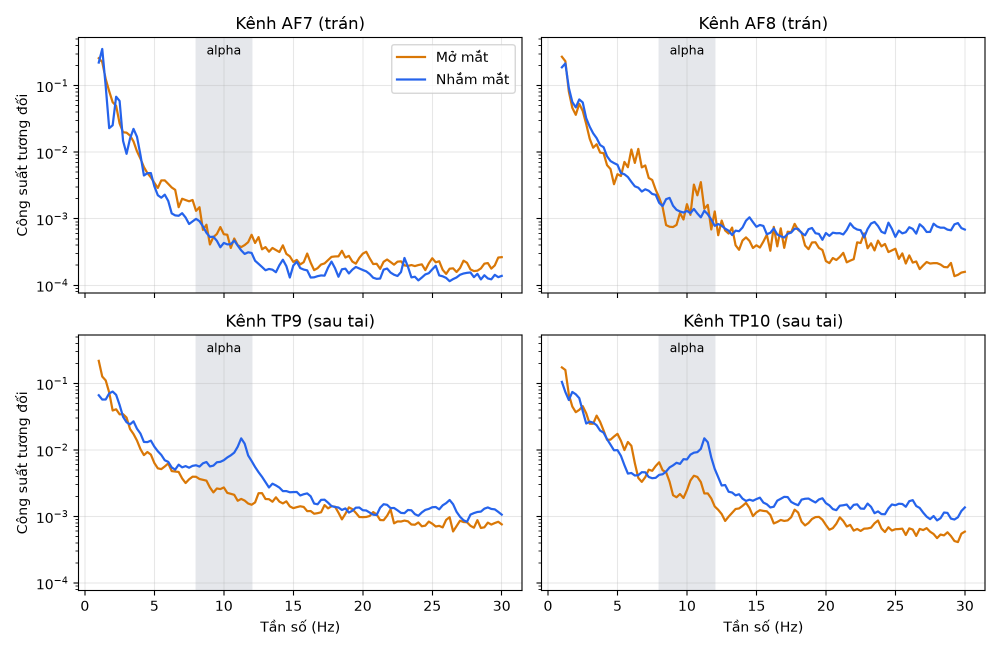
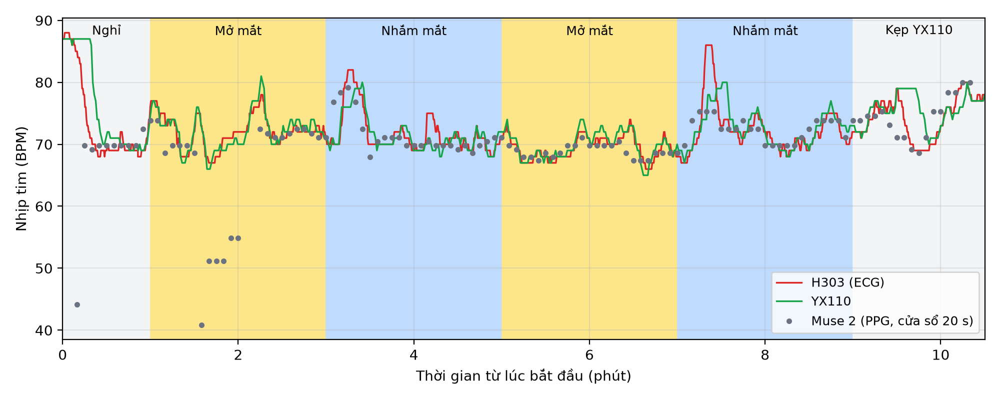

# BÁO CÁO TIẾN ĐỘ ĐỒ ÁN 2

Giai đoạn: 01/09/2026 – 01/11/2026 (đến tuần 45)

- **Đề tài:** Xây dựng hệ thống giám sát tín hiệu sinh lý (EEG, nhịp tim, SpO₂) từ thiết bị đeo, sử dụng thiết bị biên và điện toán đám mây AWS, tích hợp trợ lý giọng nói
- **Sinh viên:** Trịnh Hoàng Dũng — **MSSV:** 2310575
- **GVHD:** Nguyễn Lý Thiên Trường

## 1. Mở đầu

### 1.1. Mục tiêu đề tài

Xây dựng một hệ thống giám sát tín hiệu sinh lý, gồm bốn thành phần:

- **Thiết bị đeo:** Muse 2 (EEG), Magene H303 (nhịp tim) và Yuwell YX110 (SpO₂).
- **Thiết bị biên Raspberry Pi 4:** thu nhận và xử lý tín hiệu ngay tại chỗ.
- **AWS:** lưu trữ và tổng hợp dữ liệu.
- **Web dashboard và trợ lý giọng nói:** người dùng xem chỉ số trên web, hoặc hỏi bằng giọng nói mà không cần dùng tay.

### 1.2. Kết quả giai đoạn trước (hè 2026)

- Đã xây dựng web dashboard trên dữ liệu mẫu và bộ JSON Schema chuẩn hóa dữ liệu.
- Đã xây dựng pipeline trợ lý giọng nói (STT → LLM → TTS) chạy offline trên CPU. Sau khi benchmark, chọn cấu hình faster-distil-whisper-medium.en, qwen2.5:0.5b và Piper, giảm thời gian phản hồi từ khoảng 20 s xuống dưới 5 s mỗi lượt.

Bảng 1 đối chiếu kế hoạch đặt ra cuối kỳ hè với tình hình thực hiện.

*Bảng 1. Kế hoạch cuối kỳ hè và tình hình thực hiện*

| Kế hoạch cuối kỳ hè | Tình hình trong giai đoạn này |
|---|---|
| Triển khai AWS Services | **Đang thực hiện** (mục 4.3) |
| Kết nối Mobile App và Google Health Connect | **Thay đổi hướng.** Bỏ đồng hồ Galaxy Fit 3 và Health Connect; mọi thiết bị đeo kết nối thẳng vào Raspberry Pi (mục 3.1) |
| Đo lại pipeline giọng nói trên Raspberry Pi 4 | **Chưa thực hiện**, vì giai đoạn này ưu tiên đường dữ liệu từ thiết bị đeo |

### 1.3. Phạm vi công việc trong kỳ báo cáo

Giai đoạn này tập trung vào **đường dữ liệu từ thiết bị đeo lên cloud**, làm theo hướng "lát cắt dọc nhỏ nhất": cho dữ liệu thật đi được từ cảm biến tới web trước, rồi mới hoàn thiện từng phần. Gồm các việc:

1. thiết kế lại kiến trúc;
2. thu nhận dữ liệu từ ba thiết bị đeo;
3. chương trình xử lý trên thiết bị biên;
4. backend AWS (đang làm);
5. nối web dashboard với dữ liệu thật.

## 2. Tóm tắt tiến độ theo mốc thời gian

*Bảng 2. Tiến độ theo mốc thời gian*

| Thời gian | Hạng mục | Nội dung chính |
|---|---|---|
| 01/09 – 19/09 | … | *(TODO: điền việc đã làm; giai đoạn này git không có commit)* |
| 20/09 – 28/09 | Thiết kế, schema | Chốt kiến trúc mới, trong đó Raspberry Pi là cổng dữ liệu duy nhất; cập nhật schema. Dựng thử backend AWS rồi gỡ bỏ để làm lại theo kiến trúc mới. Chuyển máy phát triển sang Ubuntu 26.04 |
| 26/10 | Thu nhận dữ liệu | Chương trình đọc BLE kèm dashboard riêng cho từng thiết bị |
| 27/10 – 28/10 | Thiết bị biên, AWS | Chạy đồng thời 3 thiết bị trên Pi. Đo phiên mắt mở/mắt nhắm. Viết `gateway.py`. Dựng API `/sessions`. Pi gửi phiên đo đầu tiên lên AWS |
| 29/10 | AWS, web | Gửi dữ liệu tự động mỗi phút, giả lập mất mạng, web đọc dữ liệu từ API. Thêm `/measurements`, tổng hợp hằng đêm và `/vitals/latest` |
| 30/10 – 01/11 | Web | Chuyển web sang đọc tổng hợp theo ngày từ `/vitals/daily` (đang làm) |

Số liệu từ git: 24 commit, khoảng 11.900 dòng thêm và 1.500 dòng xóa.

## 3. Thiết kế hệ thống và thu nhận dữ liệu

### 3.1. Thay đổi kiến trúc

- **Lý do thay đổi.** Bỏ đồng hồ Galaxy Fit 3 và Google Health Connect, vì … *(TODO: điền lý do)*.
- **Thiết bị thay thế:**
  - **Magene H303**, đai ngực đo ECG, cho nhịp tim và RR interval;
  - **Yuwell YX110**, kẹp ngón tay, đo SpO₂.
- **Kiến trúc mới:** cả ba thiết bị kết nối BLE thẳng vào Raspberry Pi 4. Pi là **cổng dữ liệu duy nhất** lên AWS (Hình 1).
- **Quy tắc chọn nguồn khi nhiều thiết bị cùng đo một chỉ số:**
  - nhịp tim lấy H303 trước, sau đó PPG của Muse 2, cuối cùng YX110;
  - SpO₂ chỉ lấy từ YX110.

```text
Muse 2 ─┐                                                              ┌──> Web dashboard
H303  ──┼─ BLE ─> Raspberry Pi 4 (thiết bị biên) ── HTTPS ──> AWS ──────┤
YX110 ─┘           giải mã, 72 đặc trưng EEG,                API Gateway,└- -> Trợ lý giọng nói
                   tóm tắt phiên, hàng đợi SQLite,           Lambda,
                   gửi lên mỗi phút                          DynamoDB
```

*Hình 1. Kiến trúc hệ thống. Nét đứt: phần chưa kết nối.*

### 3.2. Cập nhật schema dữ liệu

- Thêm `spot_measurement_schema.json` cho số đo SpO₂.
- Sửa `daily_vitals_schema.json`: AWS tính bản ghi này mỗi đêm; bỏ số bước chân; thêm trường thiết bị nguồn.
- Mở rộng `active_session_schema.json`: thêm danh sách thiết bị và RR interval của H303.
- Bổ sung test kiểm tra schema vào `validate_schemas.py`.

### 3.3. Thu nhận dữ liệu từ ba thiết bị đeo

*Bảng 3. Giao thức và kết quả thu nhận của từng thiết bị*

| Thiết bị | Giao thức | Kết quả |
|---|---|---|
| Magene H303 | Heart Rate Service chuẩn (`0x180D`) | Đọc nhịp tim và RR interval, không cần ghép đôi (pair) |
| Yuwell YX110 | Giao thức riêng (`ffe0`/`ffe4`), không theo chuẩn Pulse Oximeter | Tự giải mã gói 10 byte gồm SpO₂, nhịp mạch và checksum |
| Muse 2 | GATT riêng (`0xFE8D`) | Thu đủ các luồng: EEG 4 kênh 256 Hz, PPG 3 kênh 64 Hz, accelerometer, gyroscope, pin |

Muse 2 đo thật trong 140 giây: tốc độ mẫu khớp thông số của thiết bị và **không mất gói nào**.

<!-- Gợi ý hình: ảnh chụp thật ba thiết bị đeo và Raspberry Pi.
 -->

### 3.4. Chạy đồng thời ba thiết bị trên Raspberry Pi

Đo 10 phút, cả ba thiết bị chạy trên cùng một adapter Bluetooth (Bảng 4).

*Bảng 4. Chạy đồng thời ba thiết bị trong 10 phút*

| Chỉ số | PC Ubuntu (đối chứng) | Raspberry Pi 4, Wi-Fi bật |
|---|---|---|
| Muse 2: số lần rớt kết nối | 1 | **0** |
| Muse 2: khoảng không nhận được gói dài nhất | 9,4 s | **0,2 s** |
| H303: số lần rớt kết nối | 0 | 0 |
| Ping tới Pi trong lúc đo | – | không mất gói |

**Kết luận:** Wi-Fi và Bluetooth của Pi 4 dùng chung một chip nhưng chạy cùng lúc vẫn ổn, nên không cần mua USB Bluetooth.

### 3.5. Kiểm tra chất lượng tín hiệu

**Quy trình đo:** nghỉ 1 phút, rồi mở mắt và nhắm mắt luân phiên, mỗi đoạn 2 phút, lặp 2 lần.

*Bảng 5. Tỉ lệ công suất sóng alpha (8–12 Hz) khi nhắm mắt so với khi mở mắt*

| TP9 | AF7 | AF8 | TP10 |
|---|---|---|---|
| **3,17** | 0,79 | 0,90 | **2,47** |

Alpha chỉ tăng ở hai kênh sau tai (TP9, TP10), đúng phân bố sinh lý của sóng alpha ở vùng sau đầu (Bảng 5). Khi nhắm mắt, phổ của TP9 và TP10 có đỉnh rõ quanh 11 Hz, còn AF7 và AF8 không có (Hình 2). Như vậy Muse 2 ghi EEG đúng.



*Hình 2. Phổ công suất tương đối (chia cho tổng công suất 1–40 Hz) của 4 kênh EEG Muse 2, trung bình hai lần mở mắt và hai lần nhắm mắt. Vùng tô xám: dải alpha 8–12 Hz.*

*Bảng 6. Nhịp tim theo từng giai đoạn (BPM)*

| Giai đoạn | Muse 2 PPG | H303 | YX110 |
|---|---|---|---|
| Mở mắt 1 | 54,9 | 71,8 | 71,9 |
| Nhắm mắt 1 | 71,1 | 71,9 | 71,6 |
| Mở mắt 2 | 68,6 | 69,3 | 69,6 |
| Nhắm mắt 2 | 72,5 | 72,8 | 73,0 |

- H303 và YX110 lệch nhau dưới 0,3 BPM.
- PPG của Muse 2 kém tin cậy hơn, có đoạn lệch tới hơn 20 BPM (Hình 3), nên chỉ dùng làm tham khảo; **nguồn nhịp tim chính là H303**.



*Hình 3. Nhịp tim theo thời gian của ba thiết bị trong phiên đo ngày 28/10/2026. Muse 2: mỗi điểm ước tính từ một cửa sổ PPG 20 s.*

## 4. Chương trình trên thiết bị biên và backend AWS

### 4.1. Chương trình xử lý trên thiết bị biên (`gateway.py`)

Một tiến trình duy nhất chạy trên Raspberry Pi:

- kết nối cả ba thiết bị và tự kết nối lại khi rớt;
- mỗi giây ghi vào hàng đợi SQLite:
  - **72 đặc trưng EEG**: 4 kênh × 18 đặc trưng (công suất các dải tần, tỉ lệ θ/α/β, chỉ số Hjorth, SEF95, spectral entropy), tính trên cửa sổ 4 giây sau lọc notch 50 Hz;
  - nhịp tim;
  - SpO₂;
- khi kết thúc mỗi phiên, tạo bản tóm tắt theo schema `active_session`;
- ghi dữ liệu thô vào thẻ SD (khoảng 75 MB/giờ).

Có test cho phần tính đặc trưng và tóm tắt phiên. Kết quả chạy thử 10 phút trên Pi ở Bảng 7.

*Bảng 7. Chạy thử `gateway.py` 10 phút trên Raspberry Pi*

| Hạng mục | Kết quả |
|---|---|
| Kết nối | Cả ba thiết bị, không rớt lần nào |
| Đặc trưng EEG | 546 dòng, đủ 72 đặc trưng, không có giá trị lỗi |
| Nhịp tim từ H303 | 518 dòng, 70,7–81,7 BPM |
| Nhịp tim từ PPG của Muse 2 | Lệch trung vị 1,7 BPM so với H303 |
| SpO₂ từ YX110 | 594 dòng, 96–100 % |

### 4.2. Gửi dữ liệu từ Pi lên AWS

- `upload.py` chạy bằng cron mỗi phút. Nó gửi các phiên và số đo chưa gửi, rồi đánh dấu trạng thái: đã gửi, chưa gửi, hoặc bị server từ chối.
- **Giả lập mất mạng** bằng cách gửi tới một địa chỉ không tồn tại: dữ liệu vẫn nằm trong hàng đợi. Khi có mạng lại, nó được gửi bù **đúng một lần**.
- Đã gửi lên AWS 2 phiên đo thật và 231 số đo SpO₂, không số đo nào bị từ chối.

### 4.3. Backend AWS (đang thực hiện)

Dựng bằng AWS SAM: API Gateway (bắt buộc API key), Lambda Python và DynamoDB.

*Bảng 8. Trạng thái các thành phần backend AWS*

| Thành phần | Trạng thái |
|---|---|
| `POST/GET /sessions`: lưu và đọc tóm tắt phiên đo, có kiểm tra schema và không tạo bản ghi trùng | Đã chạy với dữ liệu thật |
| `POST/GET /measurements`: nhận số đo SpO₂ theo lô; số đo sai bị từ chối riêng lẻ | Đã chạy với dữ liệu thật |
| Tổng hợp chỉ số mỗi đêm và `GET /vitals/daily` | Đã viết và có test, chưa kiểm tra trọn vẹn |
| `GET /vitals/latest`: chỉ số mới nhất cho trợ lý giọng nói | Đã viết và có test, chưa nối với trợ lý |
| Lưu dữ liệu thô lên S3 | Chưa làm |
| Đăng nhập người dùng (Cognito) | Chưa làm. Hiện dùng một người dùng cố định và API key |
| Cảnh báo bất thường | Chưa làm |
| CI/CD tự động deploy | Chưa làm |

### 4.4. Web dashboard

- Đọc phiên mới nhất từ API thay cho file mẫu. Đã kiểm tra trên Chrome: hiện nhịp tim 73,7 BPM lấy từ API, mở cả 4 tab không có lỗi.
- Đang chuyển thẻ chỉ số theo ngày sang đọc từ `/vitals/daily`.
- Các thẻ hồ sơ, huyết áp, hoạt động và cảnh báo vẫn đọc dữ liệu mẫu, vì chưa có API hay thiết bị đo tương ứng.

<!-- Gợi ý hình: ảnh chụp web dashboard đang hiện phiên đo thật lấy từ API.
 -->

## 5. Khó khăn và giải pháp kỹ thuật

*Bảng 9. Khó khăn và giải pháp*

| Khó khăn | Giải pháp |
|---|---|
| YX110 không theo chuẩn Pulse Oximeter Service của Bluetooth | Phân tích cách ứng dụng chính hãng xử lý dữ liệu để giải mã gói 10 byte. Kiểm tra checksum để loại gói lỗi |
| Lo ngại Wi-Fi và Bluetooth dùng chung chip trên Pi 4 sẽ làm rớt kết nối | Viết công cụ đo đồng thời 10 phút để có số liệu trước khi quyết định. Kết quả: không cần mua USB Bluetooth |
| PPG của Muse 2 cho nhịp tim sai lệch | Chọn H303 làm nguồn chính và lọc các nhịp không đều. Tỉ lệ số giây PPG lệch không quá 5 BPM so với H303 tăng từ 87 % lên 97 % |
| Pi có thể mất mạng khi đang đo | Dùng hàng đợi SQLite trên Pi; mỗi bản ghi có khóa duy nhất nên gửi lại không tạo bản ghi trùng |
| Backend AWS dựng lần đầu (20/09) quá rộng và không khớp kiến trúc mới | Gỡ bỏ và làm lại theo hướng lát cắt dọc: chỉ thêm API khi có dữ liệu thật cần dùng |
| Dữ liệu lưu theo giờ UTC, còn người dùng ở UTC+7 | Tính "một ngày" theo giờ Việt Nam khi tổng hợp chỉ số hằng đêm |

## 6. Hạn chế hiện tại

- **Backend AWS chưa hoàn thành:** còn thiếu S3, Cognito, cảnh báo và CI/CD; phần tổng hợp hằng đêm chưa được kiểm tra trọn vẹn.
- Chưa kiểm tra trọn đường với thiết bị thật sau khi bật gửi tự động, tức là đeo thiết bị rồi thấy phiên tự hiện trên web.
- Kiểm tra mất mạng mới là giả lập, chưa ngắt Wi-Fi thật.
- **Trợ lý giọng nói chưa nối với dữ liệu thật**, và chưa được đo lại trên Raspberry Pi 4.
- Chưa có phân giai đoạn giấc ngủ từ EEG; điểm tổng hợp của phiên (`overall_score`) chưa được định nghĩa.
- Không có thiết bị đo huyết áp.
- Cách chia 72 đặc trưng EEG do em tự đặt, cần thầy/cô góp ý.

## 7. Kế hoạch tiếp theo

1. Hoàn thành backend AWS: kiểm tra trọn vẹn phần tổng hợp hằng đêm, sau đó làm S3 cho dữ liệu thô.
2. Hoàn thành web đọc chỉ số theo ngày từ `/vitals/daily`.
3. Nối trợ lý giọng nói với `/vitals/latest`, để người dùng hỏi được nhịp tim và SpO₂ gần nhất bằng giọng nói.
4. Kiểm tra trọn đường với thiết bị thật, kể cả ngắt Wi-Fi thật.
5. Định nghĩa `overall_score` và quyết định phạm vi phân giai đoạn giấc ngủ.
6. Nếu còn thời gian: Cognito, cảnh báo, ứng dụng di động dạng PWA.
