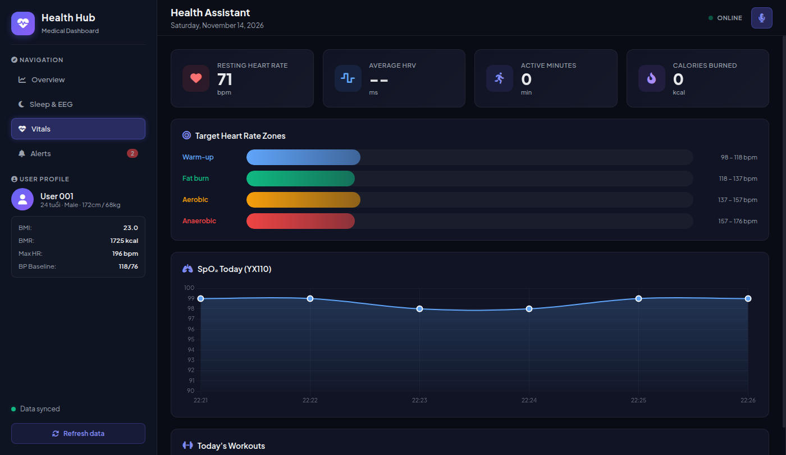
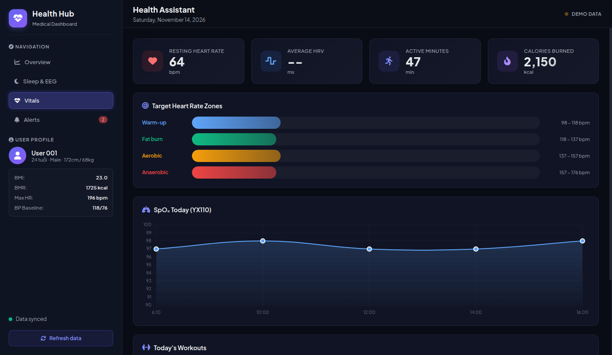

# BÁO CÁO TIẾN ĐỘ ĐỒ ÁN 2

Giai đoạn: 09/11/2026 – 15/11/2026 (tuần 46)

- **Đề tài:** Xây dựng hệ thống giám sát tín hiệu sinh lý (EEG, nhịp tim, SpO₂) từ thiết bị đeo, sử dụng thiết bị biên và điện toán đám mây AWS, tích hợp trợ lý giọng nói
- **Sinh viên:** Trịnh Hoàng Dũng — **MSSV:** 2310575
- **GVHD:** Nguyễn Lý Thiên Trường

## 1. Tóm tắt

**Mục tiêu tuần:** đưa trợ lý giọng nói lên AWS và cho trợ lý trả lời bằng số đo thật của người dùng.

**Kết quả chính:**

- Trợ lý giọng nói (STT → LLM → TTS) chạy trên **máy ảo AWS EC2**, truy cập qua HTTPS.
- Hỏi *"What is my heart rate?"* bằng giọng nói, trợ lý trả lời đúng số mới nhất trên AWS (74 BPM). Hỏi một chỉ số chưa đo, như huyết áp, trợ lý trả lời là chưa đo, không bịa số.
- Web dashboard đọc chỉ số theo ngày từ AWS. Bản công khai trên GitHub Pages chạy bằng dữ liệu mẫu, không để lộ API key.
- Đổi LLM từ `qwen2.5:0.5b` sang `qwen2.5:1.5b`, vì bản 0.5b bịa số đo (mục 4.2).

*Bảng 1. Kế hoạch cuối tuần 45 và tình hình thực hiện*

| Kế hoạch cuối tuần 45 | Tình hình trong tuần 46 |
|---|---|
| Hoàn thành backend AWS: kiểm tra trọn vẹn tổng hợp hằng đêm, làm S3 | **Chưa xong.** Tổng hợp hằng đêm chạy đều, không lỗi từ 29/10, nhưng chưa có dữ liệu mới để kiểm tra trọn vẹn. S3 chưa làm |
| Web đọc chỉ số theo ngày từ `/vitals/daily` | **Xong** (mục 6) |
| Nối trợ lý giọng nói với `/vitals/latest` | **Xong**, chạy trên EC2 (mục 3, 4) |
| Kiểm tra trọn đường với thiết bị thật, ngắt Wi-Fi thật | **Chưa làm**, chuyển sang tuần 47 |
| Định nghĩa `overall_score`, phân giai đoạn giấc ngủ | **Chưa làm** |
| Đo lại pipeline giọng nói trên Raspberry Pi 4 (kế hoạch hè) | **Bỏ**, vì trợ lý chuyển lên AWS (mục 2) |

Số liệu từ git: 16 commit (kể cả 1 merge), khoảng 1.570 dòng thêm và 630 dòng xóa, không tính các file chỉ đổi tên. Mọi commit đều trong ngày 14/11.

## 2. Thay đổi kiến trúc: trợ lý giọng nói chạy trên AWS

Trong kỳ hè, trợ lý giọng nói chạy trên máy cá nhân và dự kiến đo lại trên Raspberry Pi 4. Tuần này chuyển cả ba khối STT, LLM và TTS lên **AWS EC2**. Raspberry Pi chỉ còn thu và gửi dữ liệu cảm biến. Bộ ba model:

- **STT:** `Systran/faster-distil-whisper-medium.en` (faster-whisper, int8 trên CPU);
- **LLM:** `qwen2.5:1.5b`, chạy bằng Ollama;
- **TTS:** Piper, giọng `en_US-amy-medium`.

```text
Muse 2 ─┐                                                    ┌──> Web dashboard (GitHub Pages: dữ liệu mẫu)
H303  ──┼─ BLE ─> Raspberry Pi 4 ── HTTPS ──> AWS ───────────┤
YX110 ─┘          gateway.py,                API Gateway,    └──> EC2 (Docker): STT → LLM → TTS
                  hàng đợi SQLite            Lambda,               + web dashboard (dữ liệu thật)
                                             DynamoDB                    ↑ HTTPS qua Tailscale
                                                │                        │
                                                └── /vitals/latest, /vitals/daily ──┘
```

*Hình 1. Kiến trúc hệ thống sau tuần 46.*

## 3. Triển khai trợ lý giọng nói trên EC2

### 3.1. Đóng gói bằng Docker

Hai container chạy cùng nhau bằng Docker Compose: `ollama` (LLM) và `agent` (server FastAPI gồm STT, TTS và web dashboard). Thử trên máy cá nhân trước, rồi mới đưa lên EC2. Ba điểm cần xử lý khi đóng gói:

- **Image quá lớn:** thư viện `torch` mặc định tải bản GPU, nặng vài GB. Cài bản chỉ dùng CPU trước, vì Piper không cần GPU.
- **Lộ cấu hình:** lệnh chép mã nguồn vào image sẽ chép cả file `.env.local` và 236 MB model có sẵn trên máy. Thêm `.dockerignore` để loại các file này, và tải giọng Piper ngay trong lúc build.
- **Model STT tự đổi:** code tự chuyển sang model `tiny` khi máy dùng chip ARM hoặc có dưới 6 GB RAM. Ghi cố định cả ba model trong `docker-compose.yml` để máy nào chạy cũng giống nhau.

### 3.2. Chọn máy EC2

Tài khoản AWS dùng **Free plan** (120 USD credit, hết hạn 20/03/2027). Trong 8 loại máy được phép, chỉ `m7i-flex.large` (2 vCPU, 8 GB RAM, x86) đủ RAM cho Whisper medium và LLM cùng lúc. Giá 0,12 USD/giờ, trừ vào credit, nên **máy chỉ bật khi dùng hoặc demo**.

Không dùng Lambda, vì Lambda không giữ được kết nối WebSocket lâu, và khoảng 2 GB model làm lần gọi đầu sau khi nghỉ rất chậm.

### 3.3. Kết nối mạng và HTTPS bằng Tailscale

Trình duyệt chỉ cho dùng micro khi trang chạy HTTPS. Ban đầu dự định dùng IP cố định (Elastic IP) và Caddy để xin chứng chỉ HTTPS. Tuy nhiên nhà mạng gia đình đổi IP ra ngoài theo từng kết nối, nên quy tắc tường lửa SSH theo một IP không dùng được.

**Giải pháp:** nối EC2 vào mạng riêng Tailscale, đã có sẵn cho máy cá nhân và Raspberry Pi.

- SSH qua địa chỉ Tailscale cố định. **Tường lửa EC2 không còn mở cổng nào** cho kết nối từ Internet.
- `tailscale serve` cấp chứng chỉ HTTPS hợp lệ cho `voice-agent.taila9efcf.ts.net`, nên không cần Caddy.
- Bỏ Elastic IP, nên không còn tốn phí IP khi máy tắt.
- Khi cần người ngoài mạng Tailscale mở được, như lúc demo cho thầy/cô, bật `tailscale funnel`.

## 4. Nối trợ lý với dữ liệu thật

### 4.1. Cách trợ lý nhận dữ liệu

Trợ lý nhận số đo qua **system prompt** do web dựng từ dữ liệu đang hiển thị, rồi gửi lên server khi bắt đầu hội thoại. Web gọi thêm `GET /vitals/latest` để lấy nhịp tim và SpO₂ mới nhất, kèm thiết bị nguồn và thời điểm đo. Thời điểm được đổi từ UTC sang giờ Việt Nam trước khi đưa vào prompt.

### 4.2. Trợ lý bịa số đo và cách khắc phục

Lần thử đầu cho thấy ba loại lỗi:

- **Prompt chứa giá trị rỗng:** trợ lý đọc nguyên văn *"Your sleep score was undefined/100"*, vì web ghép cả những chỉ số không có dữ liệu vào prompt.
- **Prompt chứa số mẫu:** trợ lý trả lời huyết áp *118/76 mmHg*, lấy từ hồ sơ mẫu, trong khi hệ thống không có thiết bị đo huyết áp.
- **Model bịa số:** sau khi đã làm sạch prompt, `qwen2.5:0.5b` vẫn trả lời huyết áp *126/75*, rồi *160/100 mmHg*.

Để tách lỗi do prompt hay do model, em hỏi trực tiếp LLM trên EC2 ba câu, mỗi câu 3 lần, với hai cách viết prompt:

- **Prompt A** dặn quy tắc chung: *"nếu không có giá trị thì nói chưa đo"*.
- **Prompt B** ghi thẳng từng sự thật: *"Current heart rate: 74 bpm"*, *"Blood pressure: not measured"*.

*Bảng 2. Số câu trả lời đúng trên 3 lần hỏi*

| Model / prompt | Nhịp tim (đúng: 74) | Huyết áp (đúng: chưa đo) | SpO₂ (đúng: 99) | Thời gian LLM |
|---|---|---|---|---|
| 0.5b + A | 0/3 | 0/3 | 0/3 | ~0,8 s |
| 0.5b + B | 3/3 | 2/3 | 3/3 | ~0,8 s |
| 1.5b + A | 3/3 | 2/3 | 3/3 | ~1,5 s |
| **1.5b + B** | **3/3** | **3/3** | **3/3** | ~1,5 s |

**Nhận xét:**

- Cách viết prompt ảnh hưởng nhiều hơn kích thước model: model nhỏ làm theo sự thật được ghi ra tốt hơn làm theo quy tắc.
- Chỉ tổ hợp **1.5b + prompt B** trả lời đúng cả 9 lần, đổi lại mỗi câu chậm hơn khoảng 0,7 s. Em chọn tổ hợp này.
- Benchmark kỳ hè chọn 0.5b vì điểm chất lượng ngang các model lớn hơn. Tuy nhiên benchmark đó chấm câu trả lời chung chung, chưa kiểm tra việc trả lời đúng theo số liệu được cung cấp.

Ngoài ra, thêm gợi ý từ chuyên ngành cho Whisper (`SpO2, heart rate, HRV...`). Trước khi thêm, Whisper nghe "SpO2" thành *"S. B.O. 2."*; sau khi thêm, nghe đúng *"SPO2"* khi nói thật.

### 4.3. Kết quả hỏi bằng giọng nói trên EC2

*Bảng 3. Hỏi bằng giọng nói qua micro, cấu hình cuối*

| Câu hỏi | Trả lời của trợ lý | Đánh giá |
|---|---|---|
| What is my heart rate? | *Your current heart rate is 74 bpm.* | Đúng số mới nhất |
| What is my blood pressure? | *You have not yet measured your blood pressure.* | Đúng, không bịa số |
| What is my blood oxygen? | *Your current SpO2 is 99%.* | Đúng số mới nhất |

## 5. Thời gian phản hồi

### 5.1. Hỏi bằng giọng nói thật

*Bảng 4. Thời gian mỗi lượt khi nói qua micro*

| Cấu hình | STT | LLM | TTS | Tổng |
|---|---|---|---|---|
| Máy cá nhân (8 nhân), 0.5b, trung bình 3 lượt | 3,98 s | 1,45 s | 0,87 s | 6,31 s |
| EC2 (2 vCPU), 0.5b, lượt đầu | 6,72 s | 4,67 s | 0,51 s | 11,89 s |
| EC2, 1.5b, model đã nạp sẵn, trung bình 3 lượt | 7,49 s | 2,09 s | 0,30 s | 9,88 s |

- STT trên EC2 chậm khoảng 1,7 lần so với máy cá nhân, do chỉ có 2 vCPU.
- Ollama mặc định gỡ model khỏi RAM sau 5 phút không dùng, nên câu hỏi đầu sau mỗi lần nghỉ mất thêm khoảng 4 s để nạp lại. Đặt `OLLAMA_KEEP_ALIVE=-1` để model luôn nằm trong RAM. Sau khi đặt, LLM chỉ mất 1,5–2,6 s mỗi câu.

### 5.2. Đo tự động 10 câu hỏi

Để đo lặp lại được mà không cần nói vào micro, Piper đọc 10 câu hỏi thành file âm thanh, rồi Whisper nhận dạng lại với hai cấu hình tìm kiếm: `beam_size=3` (cũ) và `beam_size=1` (greedy, chỉ giữ một phương án). Sau đó LLM trả lời bằng đúng prompt mà web gửi.

*Bảng 5. STT trên EC2, 10 câu hỏi*

| Cấu hình STT | Trung bình | Trung vị | Nhận dạng đúng nguyên câu |
|---|---|---|---|
| `beam_size=3` | 6,34 s | 6,35 s | 8/10 |
| **`beam_size=1`** | **6,02 s** | **5,88 s** | **9/10** |

- `beam_size=1` nhanh hơn một chút và không kém chính xác, nên được chọn.
- LLM `qwen2.5:1.5b` có thời gian trung vị **1,88 s**. Cả **10/10** câu trả lời dùng đúng số thật, và câu hỏi về huyết áp, giấc ngủ đều được trả lời "chưa đo".
- **Ước tính mỗi lượt trên EC2: khoảng 8 s** (STT 5,9 s + LLM 1,9 s + TTS 0,3 s). STT chiếm khoảng 3/4 thời gian; đây là chi phí của model medium trên 2 vCPU, chọn beam chỉ bớt được khoảng 0,3 s.

## 6. Web dashboard và GitHub Pages

- Web đọc chỉ số theo ngày từ `/vitals/daily`. Các thẻ chưa có thiết bị đo (huyết áp) hiện `--` thay vì giá trị lỗi.
- **HRV tạm ẩn:** H303 gửi RR interval đều 2 lần mỗi giây với nhiều giá trị lặp, nên RMSSD tính ra (6,1 ms) không phản ánh HRV thật. Thẻ HRV hiện `--` cho tới khi có RR từng nhịp.
- **Hai đường truy cập:**

*Bảng 6. Hai đường truy cập web*

| Đường truy cập | Dùng khi | Dữ liệu | Trợ lý giọng nói |
|---|---|---|---|
| GitHub Pages | Link cố định, luôn mở được | Mẫu, có nhãn **DEMO DATA** | Không |
| EC2 qua Tailscale | Demo thật, cần bật EC2 | Thật, từ AWS | Có |

GitHub Pages là kho mã công khai. Nếu đưa API key lên đó, ai mở trang cũng đọc được key và xem được dữ liệu sức khỏe. Vì vậy bản trên Pages chỉ chạy dữ liệu mẫu, ẩn nút micro, và hiện rõ nhãn DEMO DATA. Pages cũng không nối với trợ lý, vì trợ lý sẽ đọc số mẫu như số thật.



*Hình 2. Tab Vitals khi chạy với dữ liệu thật: nhịp tim nghỉ 71 BPM, SpO₂ từ YX110 phiên 28/10, HRV hiện `--`.*



*Hình 3. Cùng tab trên GitHub Pages: dữ liệu mẫu, nhãn DEMO DATA, không có nút micro.*

## 7. Các việc khác

- **Sắp xếp lại thư mục dự án** thành `02_Outputs`, `03_Code`, `04_Data`, và cập nhật đường dẫn trong 17 file (CI, README, script kiểm tra schema). CI vẫn đạt.
- **Raspberry Pi:** chép code mới lên theo thư mục mới. Hàng đợi trên Pi còn nguyên: 3 phiên và 231 số đo SpO₂ đều đã gửi, không có bản ghi kẹt.
- **Kiểm tra toàn bộ mã nguồn**, tìm ra 6 điểm cần sửa, đã đưa vào danh sách việc. Quan trọng nhất là: phiên đo gửi lên AWS sau 00:05, ví dụ do Pi mất mạng ban đêm, sẽ không được tính vào tổng hợp ngày hôm đó.
- **Danh sách việc theo giai đoạn** từ tháng 6 tới nay, lưu trong `00_Tasks/`.

## 8. Khó khăn và giải pháp

*Bảng 7. Khó khăn và giải pháp*

| Khó khăn | Giải pháp |
|---|---|
| Free plan chỉ có máy 2 vCPU đủ RAM, nên STT chậm | Chọn `m7i-flex.large`; đo để chọn `beam_size=1`; giữ LLM luôn trong RAM |
| Nhà mạng đổi IP ra ngoài theo từng kết nối, nên SSH lúc được lúc không | Dùng Tailscale thay cho IP cố định; đóng mọi cổng của EC2 với Internet |
| Micro chỉ hoạt động trên HTTPS | `tailscale serve` cấp chứng chỉ HTTPS, không cần mở cổng 80/443 |
| LLM bịa số đo | Ghi rõ từng sự thật trong prompt, kể cả "not measured"; đổi sang `qwen2.5:1.5b`. Kiểm chứng bằng phép thử lặp lại (Bảng 2) |
| Whisper không biết từ chuyên ngành ("SpO2") | Thêm gợi ý từ (`initial_prompt`) cho Whisper |
| GitHub Pages công khai, không thể chứa API key | Pages chạy dữ liệu mẫu; dữ liệu thật chỉ có trên EC2 |

## 9. Hạn chế hiện tại

- **Thời gian phản hồi khoảng 8 s mỗi lượt** trên EC2, chậm hơn mốc dưới 5 s của benchmark kỳ hè trên máy cá nhân. Phần lớn là STT trên 2 vCPU.
- Số liệu ở mục 5.2 đo bằng giọng Piper, sạch hơn giọng thật qua micro. Phép thử LLM (Bảng 2) mới có 9 lần hỏi cho mỗi tổ hợp.
- Dữ liệu mới nhất trên AWS vẫn là phiên ngày 28/10. Chưa kiểm tra trọn đường với thiết bị thật sau khi bật gửi tự động, và chưa ngắt Wi-Fi thật.
- Trợ lý chỉ dùng được khi EC2 đang bật; cần bật trước khi demo khoảng 2 phút.
- Backend AWS còn thiếu S3, Cognito, cảnh báo và CI/CD.
- HRV chưa có số liệu đúng; `overall_score` và phân giai đoạn giấc ngủ chưa làm.

## 10. Kế hoạch tuần 47

1. Kiểm tra trọn đường với thiết bị thật: đeo thiết bị, phiên đo tự lên AWS, web và trợ lý trả lời bằng số mới. Có ngắt Wi-Fi thật.
2. Sửa lỗi phiên gửi muộn bị bỏ sót: tổng hợp hằng đêm tính lại 2 ngày gần nhất.
3. Đo lại thời gian phản hồi bằng giọng thật; nếu cần dưới 8 s thì thử model STT nhỏ hơn (`distil-small.en`).
4. Làm S3 cho dữ liệu thô.
5. Định nghĩa `overall_score` và quyết định phạm vi phân giai đoạn giấc ngủ.
