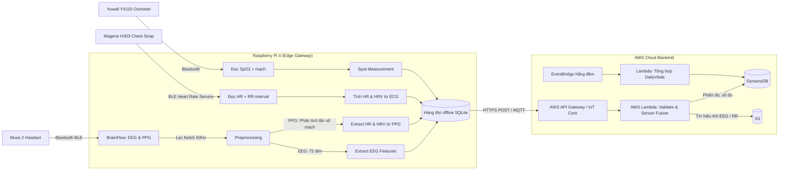
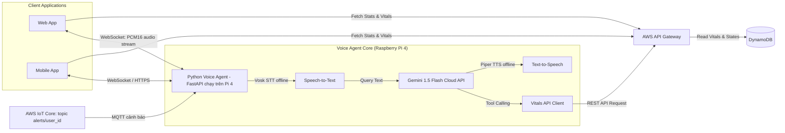

# Kế hoạch Thiết kế & Triển khai Hệ thống Trợ lý Âm thanh Y tế (Tối ưu chạy chính trên Raspberry Pi 4)

Bản kế hoạch này trình bày cấu trúc thiết kế tối ưu, lộ trình triển khai và các tính năng cao cấp cho hệ thống y tế chạy chính trực tiếp trên **Raspberry Pi 4**:
*   **Thiết bị chạy chính (Core Host):** Raspberry Pi 4 (4GB RAM) chạy Python Voice Agent (FastAPI, kết nối WebSocket trực tiếp với client) và chương trình thu thập dữ liệu từ tất cả cảm biến. Pi là **cổng dữ liệu duy nhất** đưa số liệu lên AWS.
*   **Máy trạm kết nối (Bridge PC):** Ubuntu 26.04 LTS (i5-1135G7, 16GB RAM) chỉ đóng vai trò kết nối terminal SSH, biên dịch code, và phát triển/thử nghiệm.
*   **LLM Engine:** **Google Gemini 1.5 Flash API** (Cloud API kết nối từ Raspberry Pi 4).
*   **STT Engine:** **Vosk STT** (Chạy offline cực nhẹ, tiêu tốn ít RAM/CPU trên Raspberry Pi 4).
*   **TTS Engine:** **Piper TTS** (Chạy offline qua ONNX, được tối ưu hóa đặc biệt để sinh giọng nói thời gian thực trên chip ARM của Raspberry Pi 4).
*   **Thiết bị đo EEG & PPG:** Muse 2 (Bluetooth BLE kết nối trực tiếp với Raspberry Pi 4, cảm biến PPG đo mạch ở vùng chẩm/trán chẩm).
*   **Thiết bị đo nhịp tim & HRV chính xác:** Magene H303 (đai đeo ngực đo ECG, BLE Heart Rate Service chuẩn, kết nối trực tiếp với Raspberry Pi 4; pin ~1000 giờ nên đeo được qua đêm).
*   **Thiết bị đo SpO₂:** Yuwell YX110 (máy kẹp ngón tay, Bluetooth, đo theo từng lần 5–8 giây rồi tự tắt).

> **Lưu ý thiết kế:** Hệ thống **không có thiết bị đeo nền 24/7**. Dữ liệu chỉ tồn tại khi người dùng đang đeo Muse 2 / H303 hoặc chủ động đo bằng YX110. Mọi chỉ số tổng hợp theo ngày đều do AWS tính từ các phiên đo và các lần đo này.

---

## Luồng Hoạt động Hệ thống (System Pipeline Architecture)

### 1. Luồng xử lý và Hợp nhất dữ liệu sinh học (EEG, PPG, ECG & SpO₂ Sensor Fusion)
Sơ đồ mô tả luồng dữ liệu từ Muse 2, Magene H303 và Yuwell YX110 hội tụ về Raspberry Pi 4 rồi lên AWS Cloud:



### 2. Luồng Trợ lý Giọng nói & Ứng dụng Client (Voice Agent & Clients Pipeline)
Sơ đồ mô tả luồng đàm thoại giọng nói qua WebSocket trực tiếp, tích hợp với **Google Gemini 1.5 Flash Cloud API** chạy trực tiếp trên **Raspberry Pi 4**:



---

## Kiến trúc AWS Backend (AWS Backend Architecture)

### 1. Lưu trữ dữ liệu
| Thành phần | Schema | Nguồn ghi | Nguồn đọc | Khóa |
|---|---|---|---|---|
| DynamoDB `UserProfiles` | `user_profile_schema.json` | Web/App | Pi (baseline EEG), Lambda | `user_id` |
| DynamoDB `Sessions` | `active_session_schema.json` | Pi (Muse 2 / H303) | Web, Voice Agent, Lambda tổng hợp | `user_id` + `timestamp_start` |
| DynamoDB `SpotMeasurements` | `spot_measurement_schema.json` | Pi (YX110, đo H303 buổi sáng) | Web, Voice Agent, Lambda tổng hợp | `user_id` + `timestamp` |
| DynamoDB `DailyVitals` | `daily_vitals_schema.json` | **Lambda tổng hợp hằng đêm** | Web, Voice Agent | `user_id` + `date` |
| DynamoDB `AssistantLogs` | `assistant_alerts_schema.json` | Voice Agent | Web | `user_id` + `timestamp` |
| S3 `raw/` | — | Pi (qua presigned URL) | Huấn luyện mô hình GRU RNN | `raw/<user_id>/<date>/<session_id>` |

Mọi bản ghi vitals đều mang trường `source_device` (`muse2_ppg`, `magene_h303`, `yuwell_yx110`, `simulator`) để phục vụ thuật toán hợp nhất.

### 2. REST API (API Gateway + Lambda Python)
| Endpoint | Client | Chức năng |
|---|---|---|
| `POST /sessions` | Pi | Validate schema, lưu tóm tắt phiên, trả presigned URL để upload tín hiệu thô lên S3 |
| `POST /measurements` | Pi | Lưu số đo YX110 / resting HR buổi sáng; kiểm tra ngưỡng cảnh báo |
| `GET /vitals/latest` | Voice Agent | Giá trị đã hợp nhất **kèm nguồn và thời điểm đo** (tool của LLM) |
| `GET /sessions`, `GET /measurements`, `GET /daily-vitals` | Web/App | Dữ liệu vẽ biểu đồ theo khoảng thời gian |
| `GET/PUT /profile` | Web/App, Pi | Hồ sơ người dùng và baseline |
| `POST /assistant-logs` | Voice Agent | Nhật ký hội thoại và nhật ký sức khỏe bằng giọng nói |

API ghi phải **idempotent** (khóa `session_id` / `measurement_id`) vì Pi gửi bù dữ liệu từ hàng đợi offline khi có mạng trở lại.

### 3. Xác thực & bảo mật
*   **Cognito** cho Web/App (mỗi người dùng chỉ đọc được dữ liệu của mình).
*   **Chứng chỉ IoT Core** (hoặc API key riêng) cho Raspberry Pi.
*   S3 private, mã hóa mặc định; mỗi Lambda chỉ có quyền IAM tối thiểu. Chỉ dùng dữ liệu giả lập/công khai trong giai đoạn phát triển.

---

## Chi tiết Kỹ thuật Hợp nhất Cảm biến (Sensor Fusion Details)

### 1. Thứ tự ưu tiên nguồn dữ liệu
| Chỉ số | Ưu tiên 1 | Ưu tiên 2 | Ưu tiên 3 |
|---|---|---|---|
| Nhịp tim / HRV | Magene H303 (ECG, khi đang đeo) | Muse 2 PPG | Mạch từ Yuwell YX110 (theo từng lần đo) |
| SpO₂ | Yuwell YX110 | — | — |

*   **Trong phiên đo EEG:** Nếu đeo cả Muse 2 và H303, Lambda dùng HR/HRV của H303 và lưu HR/HRV từ Muse 2 PPG song song để **đánh giá độ chính xác của PPG trên Muse 2 so với ECG** (dữ liệu phục vụ báo cáo nghiên cứu).
*   **Ngoài phiên đo:** Không có dữ liệu liên tục. `GET /vitals/latest` trả về số đo gần nhất cùng thời điểm đo để Voice Agent nói rõ ("lần đo gần nhất lúc 7 giờ sáng").

### 2. Nhịp tim lúc nghỉ (Resting Heart Rate)
*   Đo **buổi sáng ngay sau khi thức dậy**: đeo H303 2–3 phút, Pi gửi số đo `resting_heart_rate` (kèm HRV) lên `POST /measurements`.
*   Nếu không có số đo buổi sáng, Lambda tổng hợp lấy nhịp tim thấp nhất của H303 trong phiên ngủ đêm trước.

### 3. Hợp nhất phân tích giấc ngủ (Sleep Tracking Fusion)
*   Kết hợp phân tích chu kỳ sóng não EEG từ Muse 2 (giai đoạn đầu giấc ngủ, giới hạn bởi pin ~5 giờ của Muse 2) với nhịp tim/HRV từ H303 **suốt cả đêm** để dựng biểu đồ giấc ngủ.
*   Hệ thống **không theo dõi SpO₂ khi ngủ** (YX110 không đeo liên tục được).

### 4. Tổng hợp hằng ngày (Daily Aggregation)
*   EventBridge Scheduler gọi Lambda mỗi đêm, gom `Sessions` và `SpotMeasurements` trong ngày để ghi bản ghi `DailyVitals` (resting HR, SpO₂ trung bình, thời gian/điểm giấc ngủ, phút vận động và calo từ các phiên workout của H303).
*   Các trường tổng hợp là **tùy chọn**: ngày nào không đo thì bỏ trống thay vì điền giá trị giả. Hệ thống không đếm bước chân.

---

## 🚀 Các Tính năng Tối ưu hóa & Cao cấp (Premium Features)

### 1. Trợ lý Chủ động Cảnh báo (Proactive Voice Alerting)
*   **Chức năng:** Trợ lý ảo chạy trên Raspberry Pi 4 có khả năng **chủ động bắt đầu cuộc gọi thoại** cảnh báo người dùng.
*   **Kịch bản:** Khi AWS Lambda phát hiện chỉ số y tế bất thường vượt ngưỡng nguy hiểm, hệ thống publish tin nhắn lên topic MQTT `alerts/<user_id>` của AWS IoT Core; Voice Agent trên Pi (luôn subscribe topic này) phát cảnh báo bằng giọng nói. Giai đoạn đầu có thể thay bằng Pi polling `GET /alerts` mỗi 30 giây.
*   **Nhịp tim:** Chỉ cảnh báo khi đang đeo H303 hoặc Muse 2.
*   **SpO₂ thấp (YX110 < 92%):** Trợ lý đề nghị **đo lại một lần** ("Chỉ số oxy máu hơi thấp, bạn đo lại giúp tôi nhé") để loại bỏ sai số do đặt ngón tay; nếu số đo lặp lại vẫn thấp thì phát cảnh báo.

### 2. Phân tích Stress nâng cao (EEG + HRV Cognitive-Stress Index)
*   **Chức năng:** Kết hợp đồng thời dữ liệu sóng não EEG và chỉ số HRV (ưu tiên HRV từ RR-interval của H303, dự phòng HRV từ PPG của Muse 2) được tính toán trực tiếp trên Raspberry Pi 4 để đưa ra đánh giá mức độ căng thẳng của não bộ.

### 3. Nhật ký Sức khỏe bằng Giọng nói (Voice Health Logging)
*   **Chức năng:** Người dùng có thể ra lệnh ghi nhật ký hoạt động bằng giọng nói. Gemini LLM trên cloud sẽ phân tích câu nói, bóc tách thông tin có cấu trúc và gọi Function Tool để lưu trữ vào AWS.

### 4. Bài tập thở tương tác sinh học (Interactive Biofeedback Breathing)
*   **Chức năng:** Trợ lý ảo hướng dẫn bài tập thở và **tự động điều chỉnh tốc độ đếm nhịp** dựa trên nhịp tim và HRV đo được thời gian thực từ H303 (hoặc Muse 2 PPG) truyền trực tiếp qua Bluetooth tới Raspberry Pi 4.

### 5. Phân tách Ngữ cảnh Luyện tập (Workout Mode Isolation)
*   **Phát hiện (Detection):** Người dùng bắt đầu/kết thúc phiên tập bằng giọng nói ("bắt đầu tập"), hoặc Pi tự nhận biết khi nhịp tim từ H303 vượt vùng nghỉ liên tục trong vài phút. Phiên được ghi với `session_type: workout`.
*   **Cách ly EEG:** Toàn bộ tín hiệu EEG ghi nhận được trong thời gian này sẽ được dán nhãn là `Activity: Workout` để loại bỏ khỏi dữ liệu phân tích tập trung/thư giãn dài hạn nhằm tránh nhiễu do vận động cơ.
*   **Bộ lọc cảnh báo nhịp tim:** Chuyển sang **Chế độ theo dõi giới hạn tim mạch (Workout HR Zone)** dùng nhịp tim ECG từ H303: Chỉ phát cảnh báo nếu nhịp tim vượt ngưỡng tối đa an toàn tính theo tuổi ($220 - \text{Tuổi}$).

### 6. Thiết lập Tiêu chuẩn Sóng não Cá nhân hóa từ Metadata (Metadata-Driven Adaptive EEG Baseline)
*   **Phân tích Chỉ số Sức khỏe từ Metadata:** Tính toán BMI (hiệu chỉnh độ nhạy thở ngủ sâu), BMR và ngưỡng sinh lý an toàn từ Tuổi, Giới tính, Chiều cao, Cân nặng.
*   **Cân chỉnh Tiêu chuẩn Sóng não EEG thích ứng:** Raspberry Pi 4 hiệu chỉnh dải lọc tần số Alpha (Alpha dominant rhythm) tương ứng theo tuổi người dùng và cân chỉnh Baseline cá nhân hóa sau 3 phiên đo đầu tiên.

---

## Cấu trúc Thư mục Hệ thống (System Folder Structure)

```text
/home/hdung274520/Project/
├── 01_Documents/                     <-- Tài liệu nghiên cứu, sách tham khảo, biên bản brainstorm
│   ├── 02_cambridge-core_how-to-read-an-eeg_31Aug2025/  <-- Sách hướng dẫn đọc sóng não EEG (các file PDF)
│   ├── 23_AETA2025_ID63.pdf          <-- Tài liệu nghiên cứu liên quan
│   ├── yy_Brainstorms/               <-- Các ghi chép ý tưởng, slide brainstorm của nhóm phát triển
│   │   └── 01_Brainstorm 11 06 2026.pdf
│   └── zz_Mininotes.gdoc             <-- Ghi chú nhanh dự án
├── 03_Outputs/                       <-- Báo cáo kết quả dự án, tài liệu thiết kế luồng xử lý
│   ├── 01_Pipeline.md                <-- Tài liệu thiết kế luồng hoạt động hệ thống (file này)
│   ├── 02_Conda.md                   <-- Hướng dẫn thiết lập môi trường Conda
│   └── 03_CLI.md                     <-- Hướng dẫn giao diện dòng lệnh (Command Line Interface)
├── 04_Code/                          <-- Toàn bộ mã nguồn triển khai của hệ thống
│   ├── 01_audio-agent/               <-- Core Voice Agent & Edge Client chạy trên Raspberry Pi 4
│   ├── 02_aws-services/              <-- Backend AWS: API, Lambda sensor fusion, tổng hợp hằng ngày (Đang xây dựng lại)
│   ├── 03_mobile-app/                <-- Ứng dụng di động: dashboard + gọi thoại tới Pi (Dự kiến)
│   └── 04_web-app/                   <-- Giao diện Web Dashboard quản lý sinh hiệu & EEG
├── 05_Data/                          <-- Tập dữ liệu & JSON Schemas (user profile, session, daily vitals, spot measurement, alerts)
├── 06_Models/                        <-- Lưu trữ các trọng số và checkpoints của mô hình GRU RNN (Hiện tại trống)
├── 07_Experiments/                   <-- Nhật ký chạy thử nghiệm và đánh giá chất lượng mô hình (Hiện tại trống)
├── device_constraints.yaml            <-- Ràng buộc về tài nguyên thiết bị phần cứng
└── README.md                         <-- Hướng dẫn giới thiệu dự án chung
```

---

## Lộ trình Phát triển theo Cột mốc (Milestones Plan)

### 📍 Milestone 1: Thu nhận & Xử lý biên EEG + PPG + ECG + SpO₂ (Raspberry Pi 4)
*   **Mục tiêu:** Kết nối thành công Muse 2, Magene H303 và Yuwell YX110 qua Bluetooth trên Pi 4; thu nhận EEG, PPG, nhịp tim + RR-interval (H303) và SpO₂ (YX110); tính toán đặc trưng biên và HRV.
*   **Việc cần làm trước:** Quét H303 và YX110 bằng nRF Connect để xác nhận H303 có gửi RR-interval (characteristic `0x2A37`) và YX110 dùng Pulse Oximeter Service chuẩn (`0x1822`) hay giao thức riêng. Kiểm tra độ ổn định khi giữ Muse 2 + H303 kết nối đồng thời (dự phòng USB Bluetooth dongle).
*   **Sản phẩm bàn giao:** Log dữ liệu EEG (72 đặc trưng), nhịp tim/HRV từ H303 và từ PPG của Muse 2 mỗi giây, cùng số đo SpO₂ từ YX110 trên Raspberry Pi 4; hàng đợi offline SQLite lưu tạm dữ liệu.

### 📍 Milestone 2: Tích hợp Đám mây & Hợp nhất cảm biến (AWS Backend)
*   **Mục tiêu:** Xây dựng API nhận dữ liệu từ Pi (`/sessions`, `/measurements`), thực hiện thuật toán hợp nhất chỉ số theo thứ tự ưu tiên nguồn, lưu trữ vào DynamoDB/S3 và tổng hợp `DailyVitals` hằng đêm.
*   **Thứ tự thực hiện:** `Sessions` + API (dữ liệu giả lập) → Web App đọc từ API → Pi gửi dữ liệu thật + upload S3 → `SpotMeasurements` → Lambda tổng hợp hằng đêm → cảnh báo (polling, sau đó IoT Core MQTT) → Cognito & CI/CD.
*   **Sản phẩm bàn giao:** Hệ thống lưu trữ AWS hoàn thiện, tự động hợp nhất dữ liệu nhịp tim/SpO₂/giấc ngủ.

### 📍 Milestone 3: Đàm thoại Giọng nói & Tích hợp Gemini 1.5 Flash trên Pi 4
*   **Mục tiêu:** Khởi chạy Voice Agent (FastAPI, WebSocket) chạy trực tiếp trên **Raspberry Pi 4**, sử dụng Vosk STT local, Gemini API và Piper TTS local; tool `GET /vitals/latest` trả lời chỉ số kèm nguồn và thời điểm đo.
*   **Sản phẩm bàn giao:** Trợ lý ảo phản hồi trôi chảy tiếng Việt từ loa của Raspberry Pi 4 (hoặc qua ứng dụng khách Web/Mobile kết nối đến Pi 4).

### 📍 Milestone 4: Giao diện Web & Mobile App (Clients)
*   **Mục tiêu:** Hoàn thiện Web App vẽ biểu đồ tương quan sức khỏe từ AWS API; Mobile App đóng vai trò dashboard và gọi thoại tới Voice Agent (không còn đồng bộ dữ liệu từ thiết bị đeo). Có thể thay app native bằng PWA từ Web App.
*   **Sản phẩm bàn giao:** Ứng dụng Web hiển thị biểu đồ phân tích tương quan; ứng dụng di động xem dữ liệu và thực hiện cuộc gọi thoại qua WebSocket kết nối trực tiếp đến Voice Agent của Raspberry Pi 4.

---

## Verification Plan

### Automated Tests
1. **Gemini API Connectivity Test:** Chạy test script gửi prompt từ Raspberry Pi 4 kiểm tra phản hồi từ mô hình `gemini-1.5-flash` và tính đúng đắn của schema Function Calling.
2. **PPG Signal Filter Test:** Chạy dữ liệu PPG giả lập qua bộ lọc trên Pi 4 để kiểm tra độ chính xác của thuật toán tính toán nhịp tim/HRV.
3. **RR-interval HRV Test:** Chạy chuỗi RR-interval giả lập (định dạng H303) qua hàm tính HRV (RMSSD) và so với giá trị tính tay.
4. **Offline Queue & Idempotency Test:** Ngắt mạng Pi, ghi phiên đo, bật lại mạng; xác nhận dữ liệu được gửi bù đúng một lần (không trùng bản ghi trên DynamoDB).
5. **Schema Validation:** `python 04_Code/validate_schemas.py` (chạy tự động trên CI).

### Manual Verification
1. Đeo Muse 2 và Magene H303 cùng kết nối Pi 4.
2. Khởi chạy cuộc gọi thoại qua WebSocket trên điện thoại/web kết nối trực tiếp đến Voice Agent trên Raspberry Pi 4. Hỏi: *"Nhịp tim của tôi hiện tại thế nào?"*
3. Xác nhận: Trợ lý trả lời nhịp tim đo từ **H303** (ưu tiên cao nhất) và giá trị khớp với số hiển thị trên log Pi.
4. Tháo H303, giữ Muse 2, hỏi lại. Xác nhận trợ lý chuyển sang nhịp tim từ Muse 2 PPG.
5. Tháo cả hai thiết bị, đo SpO₂ bằng YX110, hỏi *"Oxy máu của tôi bao nhiêu?"*. Xác nhận trợ lý trả lời số đo YX110 kèm thời điểm đo.
6. Giả lập nhịp tim tăng vọt (và SpO₂ < 92% hai lần liên tiếp) trên AWS. Xác nhận Trợ lý tự động kích hoạt cảnh báo chủ động đến người dùng.
